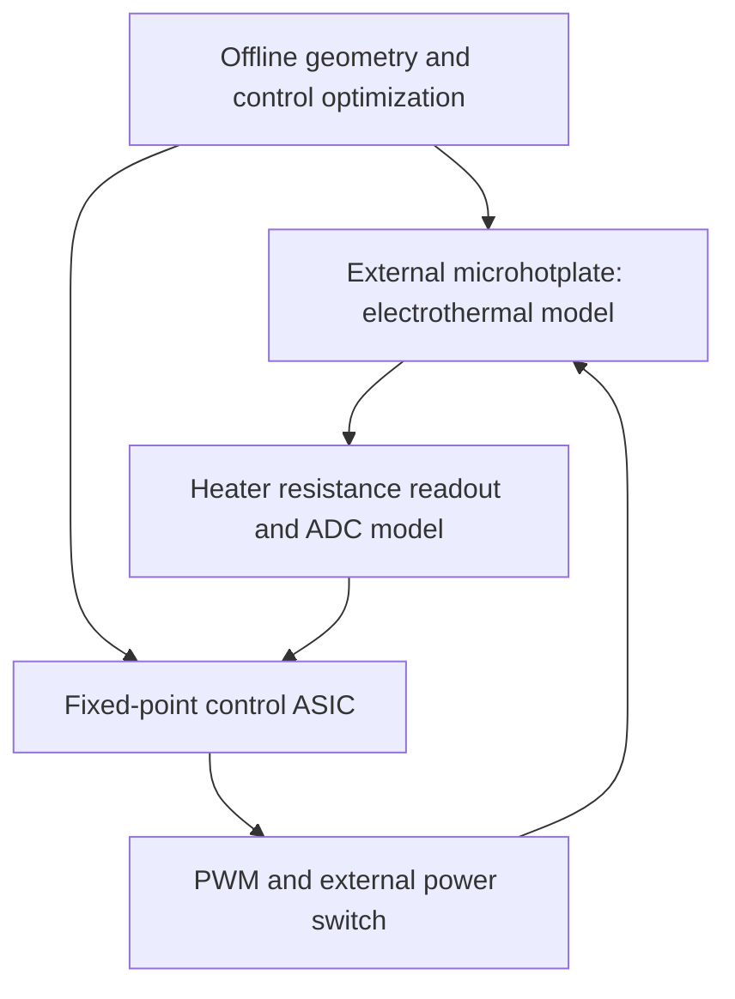

# ThermoBridge

**Electrothermal microhotplate modelling and a fixed-point sensor-controller ASIC.**

Status: project specification and execution brief, initialized 27 October 2026. Implementation, simulation results, and physical verification are pending. This repository does not yet contain a completed chip or validated performance results.

ThermoBridge studies the trade-off between heating-cycle energy, temperature accuracy, and controller hardware cost for a suspended microhotplate. The intended deliverables connect a spatial electrothermal model, a reduced-order model, a bit-accurate controller, and a routed ASIC core using open-source tools.

## Start here

- [Desktop Codex execution brief](docs/DESKTOP_CODEX_BRIEF.md): technical specification, staged implementation, experiments, acceptance gates, and publication requirements.
- [Launch prompt](START_HERE.md): copy this into desktop Codex with this repository open.
- [Agent working rules](AGENTS.md): checkpoints, evidence, and efficient execution.
- [Research and application sources](docs/SOURCES.md).

## Intended system

The hot membrane is external to the CMOS core. The ADC and power stage are external or behavioural in the first release. The chip deliverable is a digital controller core; the membrane geometry is not a foundry-qualified MEMS layout. A later, separately verified transistor-level readout macro extends the work.

## Evidence to publish as it is generated

| Deliverable | Current status |
|---|---|
| Spatial electrothermal model and numerical validation | Pending |
| Reference, fixed-point and RTL controller comparison | Pending |
| Reproducible energy / accuracy / robustness experiments | Pending |
| Synthesis, routed GDS, timing and physical verification reports | Pending |
| Analogue readout schematic, layout, LVS and extracted simulation | PFE extension, pending |
| Figures embedded in this README with raw-data links | Pending |

Figures will be embedded only after real runs produce their underlying data. Targets and planned experiments are described in the execution brief; no improvement percentages are claimed at initialization.

## Scope and contributors

Intended collaboration: [Amine Allab](https://github.com/aminemons) and [Ishaq-ML](https://github.com/Ishaq-ML). Authorship and contributor statements must reflect work actually performed and reviewed. Research motivation draws on micro/nanoelectronics, electrothermal sensing, optimization, and hardware implementation. This independent project has no EPFL affiliation or endorsement.
