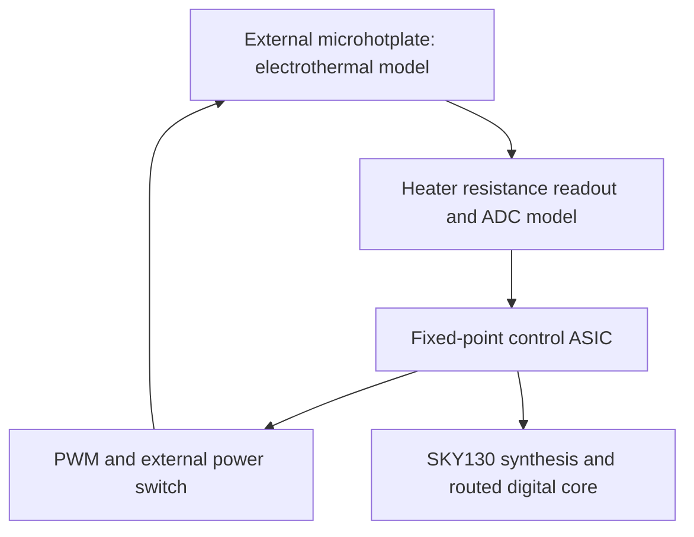
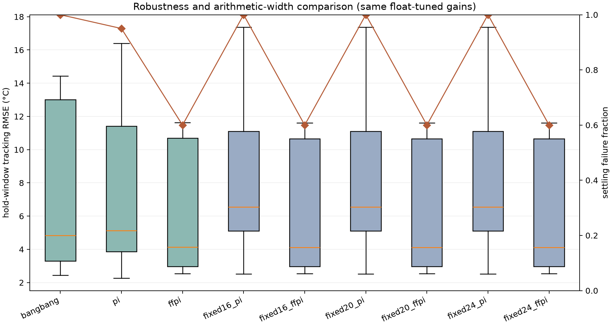

# ThermoBridge

**Electrothermal microhotplate modelling and a fixed-point sensor-controller ASIC.**

Conditional research snapshot, 27 October 2026. Real SKY130 digital GDS, numerical validation and paired experiments are available. The held-out RTL loop misses the initial 2 C tracking target; timing requires an explicit external ADC contract. This independent simulation project used Codex assistance. It contains no measured silicon or completed PFE release.

ThermoBridge connects a spatial electrothermal model, a fitted RC plant, fixed-point control and a routed ASIC core. Material properties and membrane geometry are assumed. Heater-terminal energy excludes unestimated digital-core and amplifier power.

## Evidence at a glance

| Result | Evidence / limit |
|---|---|
| Spatial FVM validation passes | Final peak refinement change **0.55%**; [validation](outputs/physics/validation.json) |
| Positive compact RC fit | Held-out RMSE **0.0443 C**, maximum error 0.0686 C; primary 4 um mesh |
| Python and actual RTL tests pass | **25 Python + 2 cocotb tests**; [verification](reports/verification.json) |
| Actual RTL-in-loop feedback | Hold RMSE **2.342 C**, **target <=2 C missed**; [run](results/raw/experiments/rtl-20261027T140947426703Z/metrics.json) |
| Routed SKY130 core | Standard-cell area **69,405.3 um2**; [GDS](results/asic/mag_gds/thermobridge_top.magic.gds), [summary](reports/asic/summary.json) |
| DRC / LVS pass | Zero route, Magic, KLayout and Netgen errors; [original reports](reports/asic/original/) |
| Timing passes conditionally | **10 MHz**, setup **+1.681 ns**, hold **+0.107 ns**, ADC arrival <=15 ns. Original20ns case: **-3.319 ns** |
| Paired Python campaign | **20 scenarios x 3 seeds x 9 variants = 540 trials**; [manifest](configs/evaluation_v1.json), [data](results/raw/experiments/exp-20261027T135345Z-7afca8/) |
| Energy-saving hypothesis not demonstrated | FFPI improves aggregate tracking but uses more heater energy than this PI baseline; settling failures remain included |

Read the [eight-page technical report](reports/technical_report.pdf), [machine-readable snapshot](reports/release_snapshot.json) and [limitations](docs/LIMITATIONS.md).

## System and scope



The membrane, ADC, power switch and ideal differential sensing front end are external to the core. RTL implements saturating PI, a 16-entry atomically committed feedforward table, calibration, PWM and latched safe-off faults. Nominal core clock is 10 MHz, control interval 1 ms. The RTL-in-loop test accelerates its divider to 32 clocks while retaining 1 ms plant time per sample; it is not a full clock-accurate PWM thermal simulation.

## Figures from executed runs


1. Actual 1 um spatial grid, assumed geometry, 50% duty. [Raw NPZ](outputs/physics/steady_1um.npz), [parameters](configs/materials.json).


2. Refinement and independent 65%-duty pulse. [Raw trajectories](outputs/physics/transient_validation.npz), [validation](outputs/physics/validation.json). ROM fitted to the primary 4 um mesh.


3. Actual cocotb/Icarus RTL drives the RC plant. Target missed. [Trace](results/raw/experiments/rtl-20261027T140947426703Z/trace.csv), [training-only selection](reports/rtl_training.json). This subset uses a centered ideal external front end distinct from the broader Python campaign.


4. Same nominal seed/cycle, Python reference controllers. [Raw traces](results/raw/experiments/exp-20261027T135345Z-7afca8/traces.csv).


5. Heater energy versus hold-window RMSE; crosses mark settling failures. [Metrics](results/raw/experiments/exp-20261027T135345Z-7afca8/metrics.csv). Not total-system energy.



6. Paired cases including failures. [Summary](results/processed/experiment_summary_exp-20261027T135345Z-7afca8.csv). Width studies share fractional precision and are not separately routed.


7. Actual generated core in KLayout. [GDS](results/asic/mag_gds/thermobridge_top.magic.gds), [view extents](docs/figures/gds_capture.json). No padframe, membrane or ADC.


8. Detail of the same routed geometry. [Physical/timing evidence](reports/asic/summary.json). Not fabricated silicon.

## Reproduce with existing tools

In PowerShell at `C:\Users\bouba\eda\ThermoBridge`:

```powershell
python scripts/container.py sync
python scripts/container.py run make test-physics test-rtl
python scripts/container.py run make simulate
python scripts/container.py fetch results/raw/experiments
```

Configured Linux environment: `make doctor`, `make test-physics`, `make test-rtl`, `make simulate`, `make figures`, `make synth`, `make gds`, `make verify-layout`, `make report`, `make release-check`. Report needs [document dependencies](requirements-report.txt). `make sweep` explicitly fails: PFE geometry optimization is pending. `python scripts/release_check.py --strict` intentionally fails the missed tracking target.

[Reproduction guide](docs/REPRODUCE.md) explains copies/fetches, historical outputs and physical-run cost. [Environment lock](docs/ENVIRONMENT.md) records the reused image/PDK. Archived routed evidence is audited by hashes. No independent clean-image full physical rerun is claimed.

## Findings and remaining work

Across 60 paired trials per floating controller, mean hold RMSE is 9.092 C (bang-bang), 9.544 C (PI), 7.125 C (FFPI). Mean heater energy is 16.512, 14.786, 16.030 uJ respectively. Settling failures are 60/60, 57/60, 36/60. These results do not demonstrate a 5-15% energy saving.

Conditional timing tightens the external ADC arrival requirement without changing geometry. Slew/capacitance warnings remain. Open-PDK checks are not foundry-qualified signoff. Formal/gate equivalence, activity-based power, three routed arithmetic variants, transistor readout macro, geometry optimization and independent 3-D/experimental validation remain pending. [Full limitations](docs/LIMITATIONS.md).

## Sources, contributions and history

[IIC-OSIC-TOOLS](https://github.com/iic-jku/iic-osic-tools), [SKY130](https://skywater-pdk.readthedocs.io/), [LibreLane](https://github.com/librelane/librelane) and upstream tools retain their licenses. [Sources](docs/SOURCES.md), [contributions](docs/CONTRIBUTIONS.md), [brief](docs/DESKTOP_CODEX_BRIEF.md). No new repository license imposed pending ownership review.

The user supplied the brief and authorized implementation. Code, runs and documentation were generated with AI assistance on 27 October 2026; human review is pending. Ishaq-ML's write invitation awaits acceptance. Commits retain real dates and authenticated authorship. No EPFL affiliation or endorsement is claimed.
