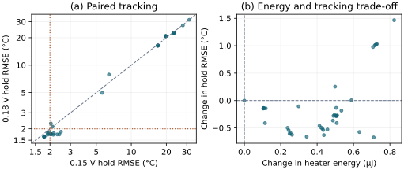

## Abstract

Increasing the simulated heater supply from 0.15 V to 0.18 V improved hold tracking in 31 of 40 paired cases. The candidate passed all predeclared gates in 19 cases, compared with eight at 0.15 V. Its median paired heater-energy change was +0.472 µJ per cycle. At both voltages, a low-resistance heater produced a zero ADC code at startup and the RTL latched a fault. The results narrow the readout and timing problems that need to be addressed before accepting the operating point.

## Method

The study paired both voltages across 20 assumed plant and readout conditions. Five fixed noise seeds were used in each of the five noisy conditions, yielding 40 pairs. The cases use a 51 °C initial target and a step to 61 °C. Variations cover ambient temperature, thermal resistance and capacitance, heater resistance and temperature coefficient, and readout gain, offset, noise and delay. The [frozen protocol](https://github.com/aminemons/ThermoBridge/blob/codex/rtl-v5-robustness/configs/rtl_study_v5.json) records each combination and seed. The ranges come from the project’s simulation assumptions.

Icarus Verilog executed the synthesizable controller in cocotb. The duty from each accepted update advanced the averaged-PWM RC plant. The next ADC value came from the nonlinear divider and 12-bit converter with the configured delay. The delay line started at ambient equilibrium. Both supplies used the same feedforward LUT, fixed Q14 gains from v3, and nominal calibration at 45 °C and 70 °C. Warm-up, hold and cooldown lasted 106, 53 and 79 ms across all cases. The thermal integration step was 1 ms and the test accelerated each controller interval to 32 RTL clocks.

Hold root-mean-square error (RMSE) and maximum positive error cover both plateaus. Settling requires 10 consecutive post-step samples within ±2 °C before cooldown. Heater energy sums simulated heater-terminal power over the complete cycle, including measurement pulses when the controller is enabled. Divider energy is recorded separately. The powered-fault metric counts warm-up and hold intervals with a latched fault.

## Results

**Table 1.** Cases clearing each simulation gate out of 40 per supply. Seed repeats count as paired runs within their respective conditions.

| Gate or metric | 0.15 V | 0.18 V |
|:--|--:|--:|
| Hold RMSE ≤2 °C | 8 | 19 |
| Hold overshoot ≤5 °C | 34 | 33 |
| Settled after the step | 21 | 20 |
| Zero faulted warm-up and hold intervals | 39 | 39 |
| All four gates | 8 | 19 |
| Median hold RMSE (°C) | 2.447 | 2.201 |

**Figure 1.** Simulated paired results for all 40 cases. Panel (a) uses logarithmic axes. The dashed diagonal marks equal tracking error and the dotted lines mark the 2 °C gate. In panel (b), changes are 0.18 V minus 0.15 V. Dashed lines mark zero change. Points can overlap. No statistical intervals are applied to these fixed cases.

Heater energy increased in 39 pairs and was zero at both supplies in the startup-fault pair. The median increase among pairs that stayed fault-free during warm-up and hold was 0.487 µJ. The isolated two-sample delay case exceeded the 0.18 V overshoot limit at 5.087 °C. All 15 seeded runs per supply from the three combined-variation conditions failed at least one gate. At 0.18 V, the largest hold overshoot was 21.798 °C in combined condition B. The [full experiment table](https://github.com/aminemons/ThermoBridge/blob/codex/rtl-v5-robustness/reports/rtl_study_v5.csv) retains every result and gate.

## Interpretation

For the tested −10% heater-resistance case, the divider code was zero at the first sample and both voltage arms latched the ADC-rail fault. The recorded heater power stayed zero through the cycle. The fault points to the fixed readout centering and calibration as a constraint on the modeled resistance range. The delay and combined-variation failures also leave the 0.18 V operating point unqualified for the full v5 envelope.

The plant uses a fitted single-node RC model and the analogue front end is behavioral. The study represents sampled closed-loop behavior under assumed ranges. Characterizing amplifier input range and settling, including extracted effects, is the next test of those assumptions.

## Reproduction and evidence

The protocol was frozen in `df10824` before v5 execution. The initial campaign completed its simulator trials but failed to serialize a non-finite readout metric after a fault. The completed campaign used `5d569b6`, which records missing readout explicitly and keeps the frozen protocol byte-for-byte. Python 3.12.3, cocotb 2.1.0 and Icarus Verilog 12.0 ran the study. All 16 v4 evaluation rows were replayed before v5 and matched the frozen tracking, overshoot, energy, and fault metrics.

From the project root, run `make simulate-robustness` in a scratch checkout and `make verify-robustness` to audit the archived traces. Use `python scripts/plot_rtl_robustness.py` to regenerate the table and figure. The verifier checks the paired inputs, RTL logs and manifest hashes and recomputes metrics from all 80 raw traces.

[Study index](https://github.com/aminemons/ThermoBridge/blob/codex/rtl-v5-robustness/reports/rtl_study_v5.json) · [Manifest, trace archive and regression logs](https://github.com/aminemons/ThermoBridge/tree/codex/rtl-v5-robustness/results/rtl_study/rtl-robustness-20261118T170918600085Z)
