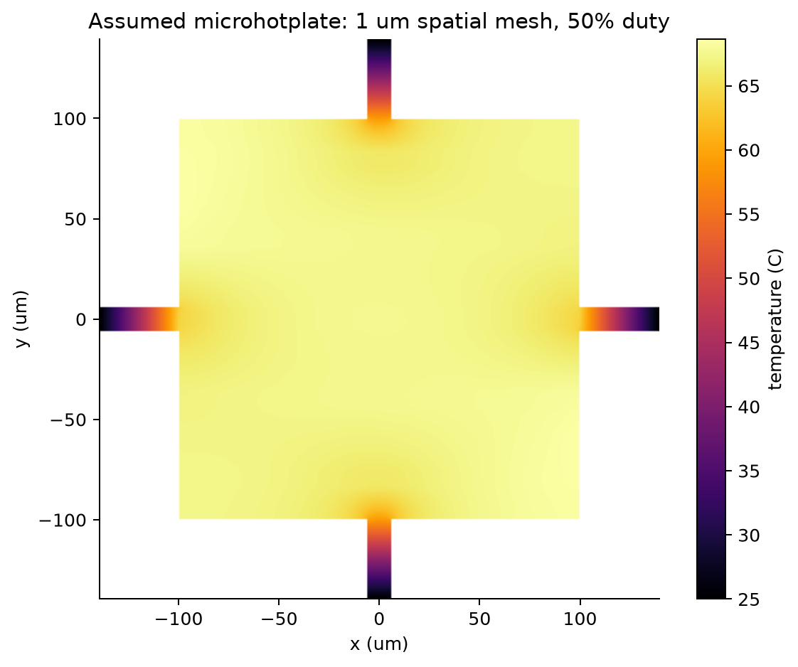
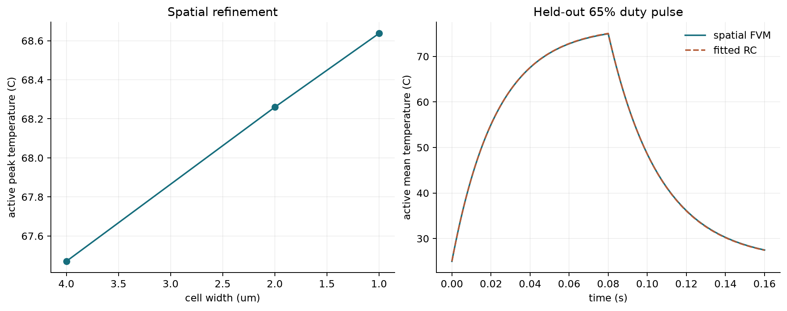
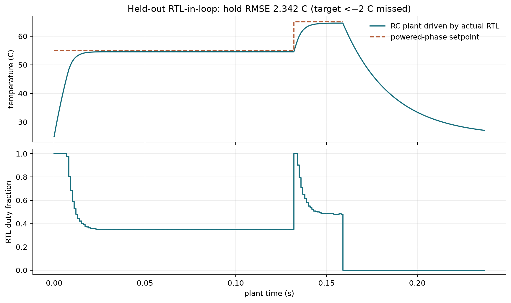
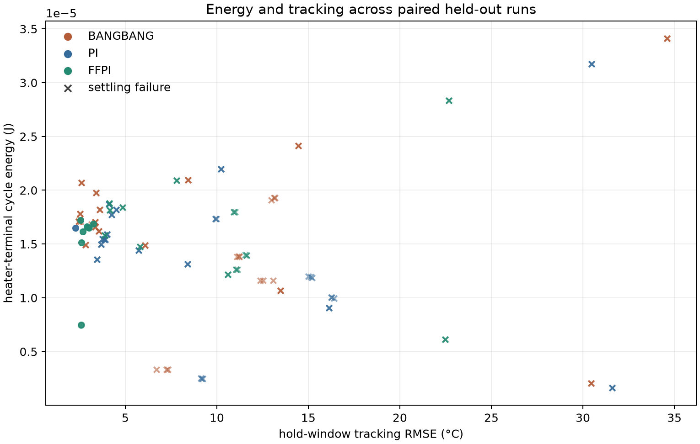

# ThermoBridge technical report
27 October 2026 | conditional research snapshot

1. Question, scope and evidence

## Question, scope and evidence
ThermoBridge

Electrothermal modelling and a fixed-point sensor-controller ASIC

Research question: can a spatially informed feedforward plus PI controller improve microhotplate tracking while retaining a small, verifiable digital implementation? This snapshot builds a traceable path from assumed membrane physics to a routed SKY130 digital core. It does not establish a new control algorithm or experimentally validated sensor performance.

All material properties and process-independent membrane dimensions are assumptions. The membrane, ADC, differential sensing amplifier and heater switch are external to the digital core. There are no measured silicon, fabricated membranes, gas-selectivity data or certified operating limits. Heater energy is distinct from unestimated digital-core and amplifier power.

Technical snapshot: 27 October 2026. Project authors: Amine Allab and Ishaq Kolla. The numerical and physical findings are bounded by the documented verification conditions; independent reproduction remains necessary. See docs/CONTRIBUTIONS.md.

2. Spatial electrothermal model

## Spatial electrothermal model
The model solves div(sigma(T) grad(phi))=0 and a thin-film thermal balance C_A dT/dt = div(K_A grad(T)) + q_J - q_loss, with local Joule heating and temperature-dependent resistance. Harmonic face conductance preserves interface fluxes. Anchors are held at ambient; suspended boundaries have zero lateral flux. Boundary loss coefficients and layer properties are declared in configs/materials.json.

The active membrane is 200 um square with a 40 um extension, 12 um anchors and a heater represented by 8 um traces at 40 um pitch. A 0.15 V heater supply and 25 C ambient define the primary case. Sparse finite-volume systems cover the resolved geometry; steady electrical and thermal solves are iterated to convergence. Transients use an electrically lagged source with implicit thermal integration.

Figure 1. Actual 1 um-grid solution at 50% duty. Source: outputs/physics/steady_1um.npz. Assumed geometry, not a foundry MEMS layout.

At 1 um, the active mean is 67.148 C and peak 68.637 C. Terminal power is 0.118094 mW. Electrical and thermal balance residuals are below 1e-8 relative. These are internal conservation checks, not agreement with a physical measurement. Through-thickness gradients, interfacial thermal resistance and independent 3-D validation are absent.

3. Numerical validation and compact reduction

## Numerical validation and compact reduction
Figure 2. Spatial refinement and a held-out pulse/cooldown. Sources: validation.json and transient_validation.npz under outputs/physics.

The RC model obeys Cth dT/dt = P - (T-Ta)/Rth with P=d V^2/R(T). Positive parameters were fitted to the primary geometry training trajectory, then frozen. Its held-out maximum absolute error is 0.0686 C. Accuracy at another geometry, temperature range or unmodelled loss mechanism is not implied.

A separate bounded PWM test compares analytic on/off RC phases against period-averaged heating at 39.0625 kHz, for duties 0.25, 0.50 and 0.75 over 800 periods. Maximum endpoint disagreement is 0.00550 C, with maximum intra-period ripple 0.01150 C. This supports averaging in this regime, not a spatial switched-PWM validation. See reports/pwm_validation.json.

4. Readout, arithmetic and fault verification

## Readout, arithmetic and fault verification
A nonlinear resistance divider drives a quantized 12-bit ADC. R(T)=R0[1+alpha(T-25 C)]; gain, offset, noise, delayed samples and exact continuous-time two-state RTN are configurable. Samples without a valid powered observation window are invalid. A 1/256 probe at commanded-zero powered samples is included in heater energy. Cooldown remains off. Sensing-source energy is counted separately; amplifier and digital switching energy are unavailable.

Tests cover reference rounding/saturation, atomic configuration, PWM endpoints, controller comparisons, reset, fault latching and clearing. The cocotb harness records 271 accepted temperature comparisons and 267 controller comparisons, including a seeded 261-code ADC sequence and directed tests. Both RTL wrappers inspect XML results and fail nonzero when cocotb fails; historical aborted runs are retained as failed evidence.

These are simulation checks. There is no completed formal proof, post-route gate-level equivalence, physical ADC clock-domain validation or hardware board test. Numeric width variants use the same fractional precision and were not independently routed, so no silicon-area advantage is claimed.

5. Held-out actual RTL feedback

## Held-out actual RTL feedback
The actual synthesizable controller, executed by Icarus/cocotb, supplies duty at each plant sample; the fitted RC and nonlinear ADC return the next observation. Six actual-RTL training candidates used a 50-to-60 C schedule. Selected KP=1147/16384 and KI=4/16384 per sample were frozen before a 55-to-65 C held-out run. This subset uses an ideal external centered front end (18 mV excitation, 8.6 mV reference, gain 800, calibration at 40/80 C); it is distinct from the broader Python campaign.

Figure 3. Real RTL-in-loop trace: results/raw/experiments/rtl-20261027T140947426703Z/trace.csv. The accelerated divider is 32 clocks per plant sample.

Held-out hold-window RMSE is 2.3424 C, above the initial <=2 C target. Total heater-terminal energy is 16.683 uJ: warmup 10.764 uJ, hold 5.918 uJ and cooldown zero. Separate sensing-source energy is 0.290 uJ. No powered-phase faults occurred; off-state cooldown eventually latches stale while PWM remains off.

The test advances physical plant time by 1 ms per accelerated control tick. It is not a full clock-accurate simulation of each physical PWM period. The timebase acceleration, ideal front end and finite held-out subset limit system-level conclusions. No test-window substitution or success claim hides the target miss.

6. Paired campaign and negative results

## Paired campaign and negative results
The frozen manifest spans ambient, thermal resistance/capacitance, heater resistance/TCR, front-end gain/offset, noise, latency and combined cases. Seeds 11, 29 and 47 are paired across controllers. Three separate training scenarios select gains before testing. Each cycle uses 4 tau warmup, 2 tau hold with a midpoint setpoint step, and 3 tau cooldown. Assumed variations are scenarios, not empirical yield distributions.

Figure 4. Each point is a paired scenario/seed trial; crosses identify settling failures. Source: primary campaign metrics.csv. Energy includes heater probe pulses.

Feedforward plus PI improves aggregate tracking relative to this PI tuning but consumes more average heater energy. It does not demonstrate the proposed 5-15% energy saving. Settling failures are common and remain in the table. Fixed-point 16/20/24-bit variants at the same six temperature fractional bits have essentially identical aggregate performance; this does not establish a hardware Pareto frontier. Earlier unrelated 5 V RC experiments are historical, not primary evidence.

7. Implemented SKY130 digital core

## Implemented SKY130 digital core
The existing installed IIC-OSIC-TOOLS image and SKY130A sky130_fd_sc_hd library were reused. A complete LibreLane flow produced GDS, DEF, LEF, mapped/powered netlists and extracted SPEF. Reported standard-cell area is 69,405.3 um2 and core area 158,379 um2. These include the stated flow conventions, not a packaged die area. No activity-qualified digital-power estimate is available.

Figure 5. KLayout capture of actual generated GDS. View extent and source are recorded in docs/figures/gds_capture.json. No pads, ADC or membrane are present.

Original route checks: zero detailed-route, Magic DRC, KLayout DRC, antenna and Netgen LVS errors. At 100 ns clock with 20 ns ADC input delay, worst setup slack was -3.319 ns. The same geometry was rechecked with an explicit 15 ns ADC code/valid arrival contract; other I/O budgets remain 20 ns. Worst setup is +1.681 ns and hold +0.107 ns across nine installed timing corners. There are no disabled or multicycle timing paths.

This is a conditional interface qualification. It requires the external source to satisfy the tighter ADC budget and is not a measured maximum frequency. Slew/capacitance warnings and floating-net observations remain in raw reports. Installed open-PDK checks are not foundry-qualified tapeout signoff. Original failing metrics remain archived; the authoritative conditional summary is reports/asic/summary.json.

8. Reproduction, limits and next work

## Reproduction, limits and next work
Repository: https://github.com/aminemons/ThermoBridge. Begin with README.md and reports/release_snapshot.json. The latter hashes RTL, constraints and primary numerical/experiment evidence. Every primary run retains configuration, seed, manifest, logs and raw values. Tools/PDK revisions are in reports/environment.json. Histories use ordinary current timestamps, and no unobserved human contributions are assigned.

Windows with the existing container: python scripts/container.py sync; python scripts/container.py run make test-physics test-rtl; python scripts/container.py run make simulate. Use selective fetch for results. Inside the configured Linux tool environment: make doctor, make test-physics, make test-rtl, make simulate, make figures, make synth, make gds. Full physical design is explicit and expensive; verify-layout audits archived physical evidence without silently rerouting.

For this archived report on the host: install requirements-report.txt, run python scripts/evidence_figures.py and python scripts/build_report.py. make release-check audits the conditional research snapshot; make release-check with scripts/release_check.py --strict also enforces the missed <=2 C target and returns failure. Geometry optimization via make sweep is explicitly unimplemented and fails nonzero.

Next work: improve training and sensing calibration on a new held-out protocol; independently reproduce the physical flow; resolve remaining electrical warnings; route arithmetic alternatives and quantify area/timing/activity-based power; implement the transistor readout macro with its own DRC/LVS/extracted simulations; add geometry Pareto studies and independent 3-D or measured validation. None is claimed complete here.

Primary sources and modest novelty

IIC-OSIC-TOOLS, existing open-source tool distribution: https://github.com/iic-jku/iic-osic-tools

SkyWater SKY130 open PDK documentation: https://skywater-pdk.readthedocs.io/

LibreLane source and flow implementation: https://github.com/librelane/librelane

KLayout documentation: https://www.klayout.de/doc/

Cocotb verification documentation: https://docs.cocotb.org/

Model assumptions and acceptance criteria: configs/physics.json, configs/evaluation_v1.json and docs/LIMITATIONS.md; code and raw results are retained in the repository.

The contribution is an auditable integration exercise connecting conventional electrothermal, compact-model and PI-control methods with fixed-point hardware. A systematic literature survey and independent comparison are still needed before asserting research novelty.
