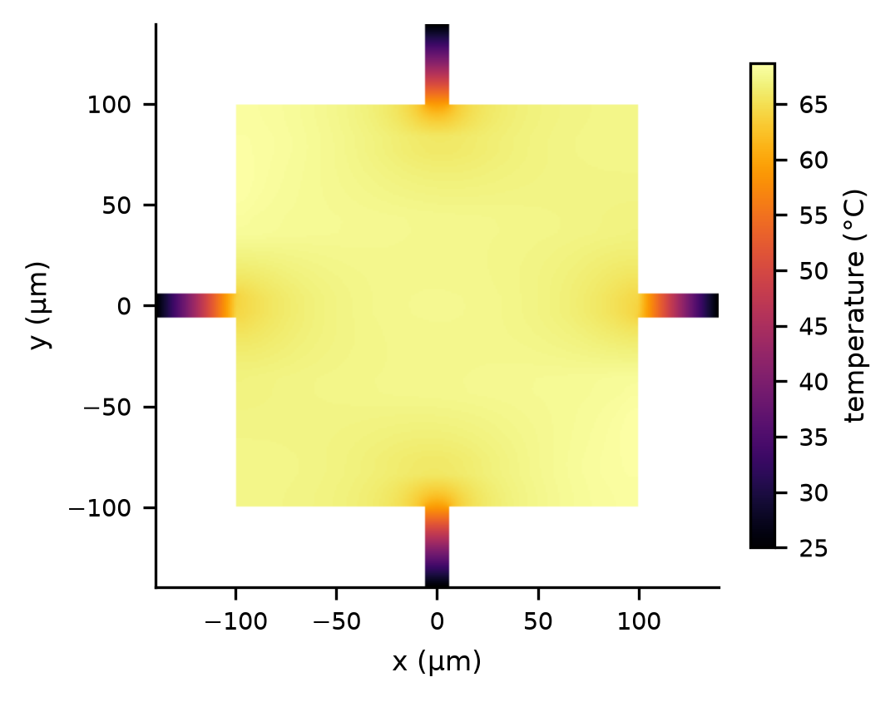
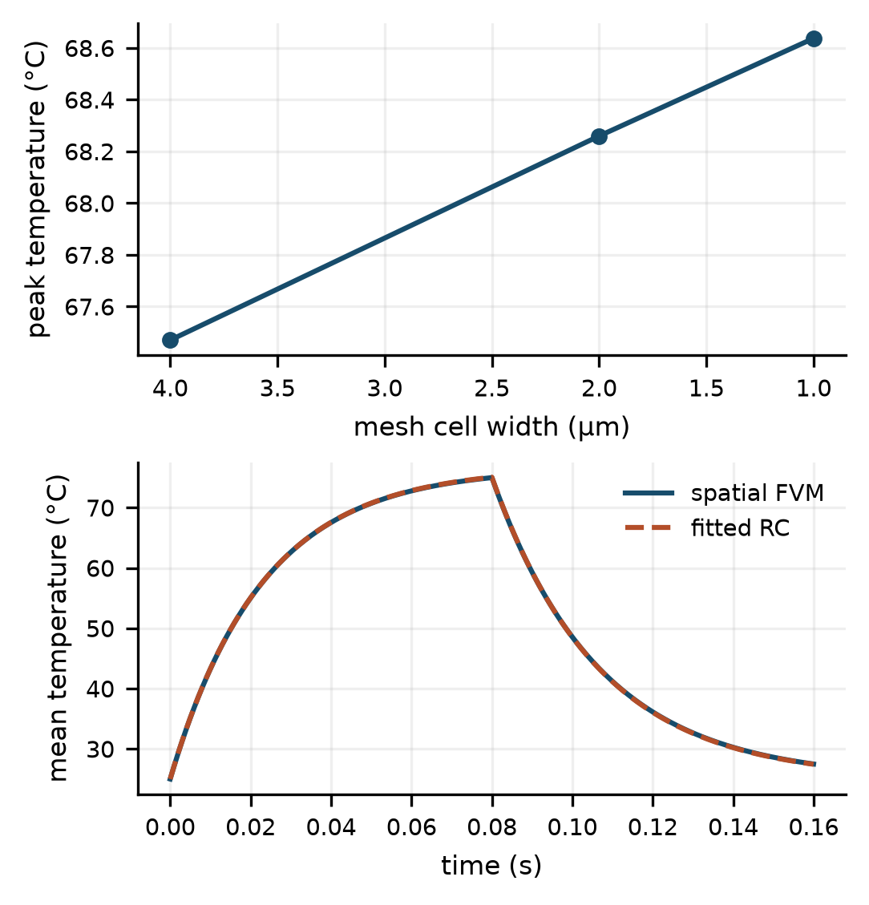
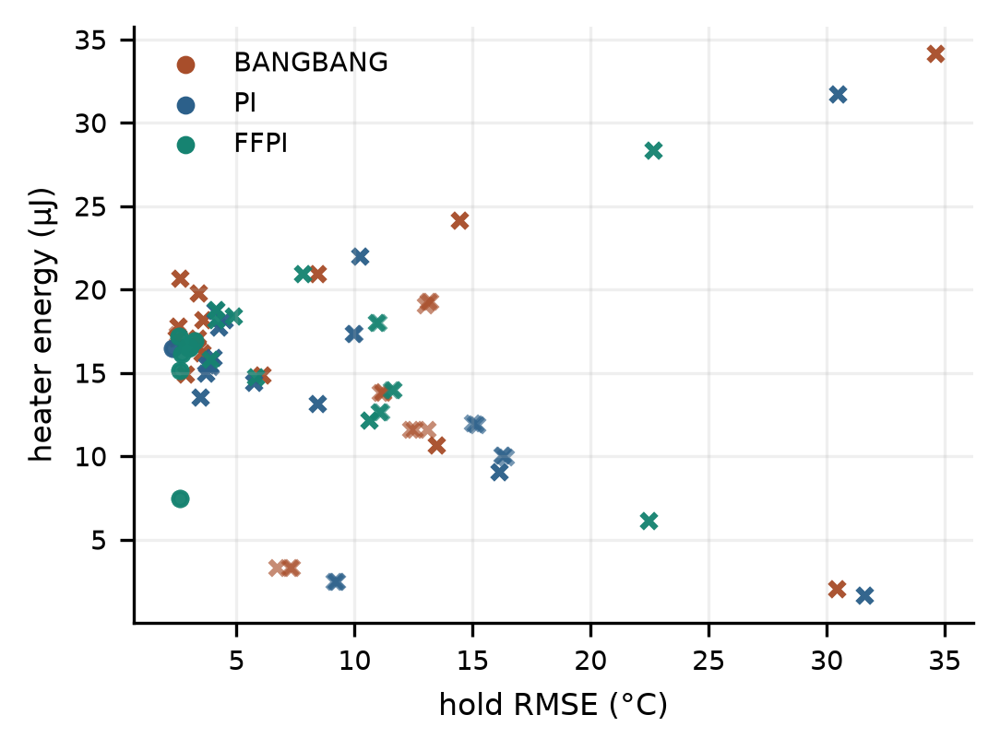
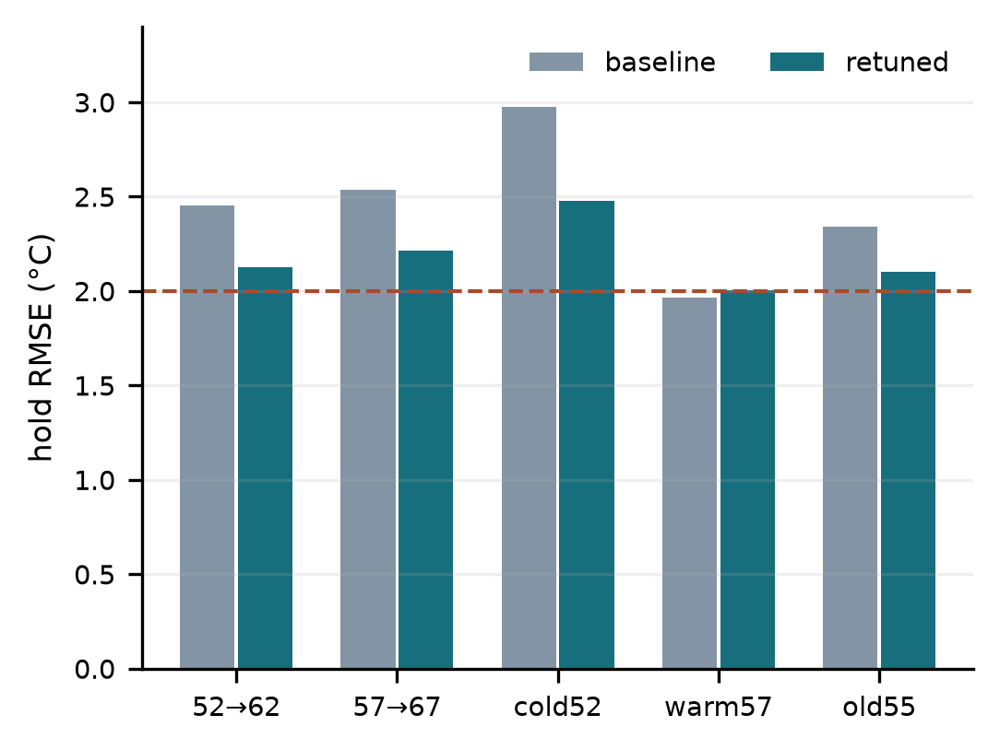
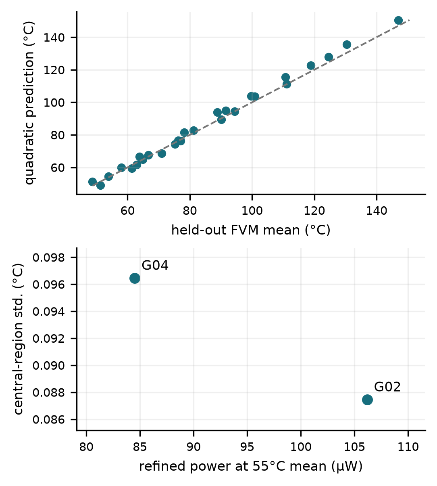
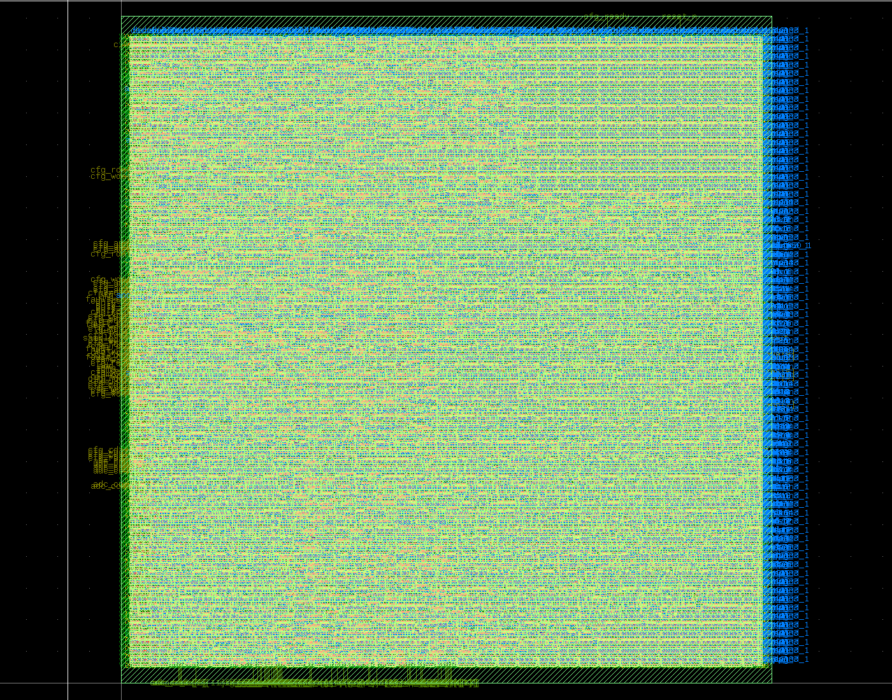
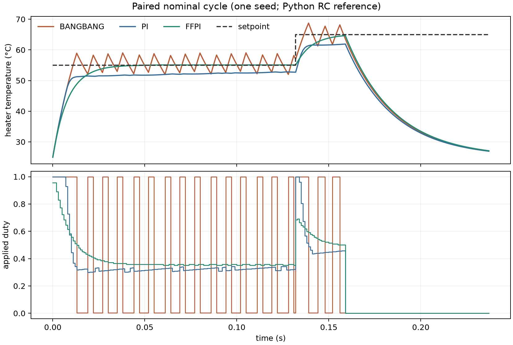
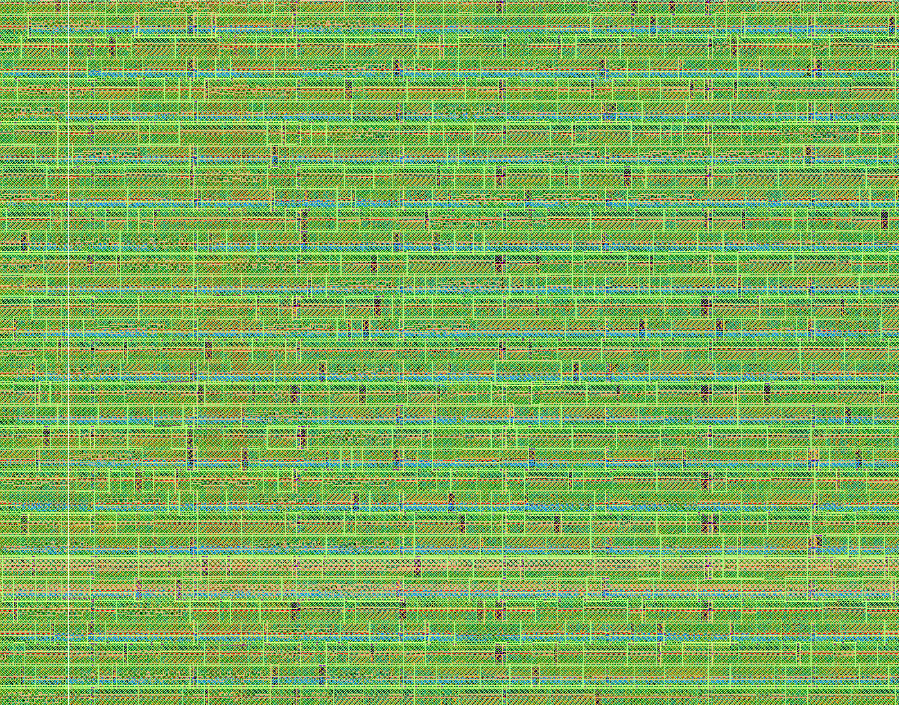

# ThermoBridge: Electrothermal Modelling and Fixed-Point Control of a Microhotplate

**Technical report · Revision 2 · 30 October 2026**

**Authors:** [Amine Allab](https://github.com/aminemons) and [Ishaq Kolla](https://github.com/Ishaq-ML)

[Two-column article](../reports/thermobridge_article.pdf) · [Reproduction guide](../docs/REPRODUCE.md) · [Contributor guide](../docs/CONTRIBUTOR_QUICKSTART.md) · [Revision review](../docs/REVIEW_20261030.md)

## Abstract

Microhotplate control couples temperature-dependent electrical heating, spatial thermal nonuniformity, sampled resistance readout and finite-precision feedback. This work presents a reproducible simulation-to-layout study of that coupling. A two-dimensional thin-film finite-volume model is reduced to a positive-parameter thermal network and connected to a synthesizable feedforward-plus-PI controller. The spatial model passes analytical, conservation and refinement checks; the compact model achieves a held-out temperature error of 0.0443 °C RMS for the primary geometry. A new geometry study evaluates 27 geometries at three operating points, reserves nine whole geometries for surrogate testing, and refines selected training candidates. Actual RTL-in-loop experiments expose an integral-action quantization dead zone and evaluate a bounded register-level retuning without changing the implemented circuit. The original regression improves from 2.342 to 2.101 °C RMS, while four newly evaluated cases remain above the 2 °C objective. A routed SKY130 core passes the installed design-rule and layout-versus-schematic checks; 10 MHz timing is conditional on a 15 ns ADC input-arrival budget. Results support an auditable prototype, but do not establish energy savings, experimental sensor accuracy or fabrication readiness.

**Index Terms—** Microhotplates, electrothermal simulation, finite-volume methods, fixed-point arithmetic, feedback control, open-source ASIC design.

## I. Introduction

Suspended microhotplates provide local temperature control with low thermal mass. Earlier fabricated systems combined heaters, sensing films and interface electronics [1]. Temperature-programmed operation also makes calibration stability and heterogeneous integration central engineering concerns [2]. Those demonstrations motivate the present control problem; their measured gas response, thermal performance and process capability are not results of this project.

ThermoBridge asks a narrower question: how do spatial-model reduction, resistance readout and finite arithmetic affect a controller that can be taken through an open digital implementation flow? The contribution is a reproducible integration study, rather than a new PI algorithm or a claim of superior sensor fabrication. Its evidence comprises a validated assumed-geometry model, recorded negative control results, actual RTL feedback experiments, and a routed digital core with explicit verification limits.

The external membrane, sensing front end, ADC and heater power switch are separate from the 1.8 V CMOS core. The assumed 0.15 V heater supply and approximately 45–70 °C control schedules serve model and controller evaluation. They do not demonstrate a high-temperature gas-sensing application. The reference implementation uses IIC-OSIC-TOOLS [3], SKY130A [4] and LibreLane [5].

## II. Electrothermal and Readout Models

### A. Spatial formulation

The suspended active region is 200 × 200 µm, with a 40 µm domain extension and four ambient-temperature anchors. The primary serpentine has an 8 µm trace width and 40 µm pitch; anchor width is 12 µm. Material properties, environmental losses and validity limits are explicit assumptions in [materials.json](../configs/materials.json) and [physics.json](../configs/physics.json).

The electrical and thin-film thermal balances are

$$
\begin{array}{lr}
\displaystyle \nabla\cdot[\sigma(T)\nabla\phi]=0 & \text{(1)}
\end{array}
$$

$$
\begin{array}{lr}
\displaystyle C_A\frac{\partial T}{\partial t}=\nabla\cdot(K_A\nabla T)+q_J-q_{\mathrm{loss}} & \text{(2)}
\end{array}
$$

Here, the sheet heat capacity and conductance include the heater only where its mask is present. Harmonic face conductances enforce conservative interface fluxes. Anchors are fixed at ambient and suspended lateral boundaries are adiabatic. The sparse steady solution iterates electrical heating and thermal response. Transients use implicit thermal integration with an electrically lagged source, whose splitting error is assessed by time-step refinement.



**Fig. 1.** Actual 1 µm-grid solution at 50% duty, with assumed geometry and boundary conditions. [Field, masks and coordinates](../outputs/physics/steady_1um.npz).

### B. Compact plant and sampling

The reduced plant is

$$
\begin{array}{lr}
\displaystyle C_{\mathrm{th}}\dot T=P-\frac{T-T_a}{R_{\mathrm{th}}},\qquad P=\frac{dV_h^2}{R_h(T)} & \text{(3)}
\end{array}
$$

The positive fitted parameters are 349,137 K/W and 75.895 nJ/K, giving a 26.498 ms time constant. They describe the primary 4 µm spatial discretization, rather than a universal microhotplate. A separate 65%-duty pulse and cooldown test is reserved for compact-model evaluation.

Heater resistance follows a declared linear temperature coefficient. A nonlinear divider, external gain stage and 12-bit ADC model represent quantization, delay, gain/offset error and noise. Samples outside observable powered windows are invalid. A 1/256 heater probe at commanded-zero powered samples is included in heater energy; cooldown remains off. Divider-source energy is reported separately. Amplifier and digital switching power are unavailable.

## III. Controller and Verification Method

### A. Implemented arithmetic

The [RTL](../rtl/thermobridge_top.sv) uses signed 16-bit temperature with six fractional bits, signed 18-bit coefficients with 14 fractional bits, a 24-bit integrator and a 26-bit combined sum. Rounding is nearest with ties to even; saturators and anti-windup bound state and output. A 16-entry, 9-bit feedforward table is configured through shadow registers and an atomic commit. The duty range 0–256 gives exact off/full endpoints for an eight-bit PWM phase counter.

The nominal 10 MHz clock produces 39.0625 kHz PWM and a 1 ms control interval. Stale data, rail values, invalid calibration, overtemperature and shutdown invoke latched safe-off behaviour. Fault clearing and reset are tested explicitly. Cocotb [6] compares real Icarus RTL outputs against the integer reference. Current checks comprise **26 Python tests and two directed/randomized RTL tests**; the v2 study adds **46 actual RTL-in-loop runs**.

### B. Integral quantization and frozen retuning

The implemented integral increment is quantized to whole Q8 duty counts:

$$
\begin{array}{lr}
\displaystyle \Delta I=\mathrm{round}_{\mathrm{even}}\!\left(\frac{K_{i,\mathrm{q14}}e_{\mathrm{q6}}}{4096}\right) & \text{(4)}
\end{array}
$$

At a 1 °C error, the original coefficient 4 gives a zero increment. The new study therefore tests supported coefficient settings without changing RTL or invalidating its routed geometry. The [frozen v2 protocol](../configs/rtl_study_v2.json) evaluates 12 coefficient pairs on three training schedules. Selection minimizes mean training hold RMSE; a selection file is written before evaluation starts.

Four evaluation cases introduce new setpoints, seeds and ambient/noise conditions. The previously observed 55→65 °C schedule is labelled a regression, not a new held-out test. Both baseline and retuned coefficients run on each identical case. The external ideal centred front end uses 18 mV excitation, an 8.6 mV reference, gain 800 and noiseless two-point calibration at 40/80 °C. Its energy is not a transistor-level amplifier measurement.

### C. Geometry exploration

The [spatial-screen protocol](../configs/geometry_study_v1.json) varies trace width over 8/12/16 µm, pitch over 32/40/48 µm and anchor width over 8/12/16 µm. Each actual mask is solved at duties 0.35, 0.50 and 0.65 on a 4 µm grid. A fixed split reserves nine entire geometries before solving; a regularized quadratic surrogate is fitted to the remaining 18. Held-out scores cannot influence candidate selection.

Training geometries that bracket a 55 °C mean are interpolated for power/nonuniformity screening. Selected points on that discrete training front are solved again on a 2 µm grid, with duty found by bisection and an independently executed 160 ms transient. This is a bounded steady-state screening exercise. It is not a closed-loop energy Pareto optimum, Bayesian-optimization benchmark or evidence of global optimality.

## IV. Results

### A. Numerical validation

**Table I. Numerical-model validation.**

| Quantity | Observed result | Interpretation |
|---|---:|---|
| Rectangular resistance | 0.655875 vs 0.6625 Ω | 1% continuum/discrete difference |
| Peak at 4 / 2 / 1 µm | 67.470 / 68.260 / 68.637 °C | 0.55% final refinement change |
| Balance residuals | Below 1e-8 relative | Internal conservation, not measurement agreement |
| Compact held-out RMSE / maximum error | 0.04427 / 0.06857 °C | Unseen pulse amplitude and duration |
| 1 ms vs 0.5 ms transient | 0.385% normalized difference | Recorded splitting/time-step sensitivity |
| Switched vs averaged RC PWM | 0.00550 °C maximum endpoint difference | Three duties, 800 cycles each |



**Fig. 2.** Mesh refinement and held-out pulse response. [Validation JSON](../outputs/physics/validation.json), [raw transient arrays](../outputs/physics/transient_validation.npz), [PWM check](../reports/pwm_validation.json).

### B. Paired reference campaign

The original Python campaign freezes 20 variation scenarios and three seeds across three floating controllers and six arithmetic profiles: 540 trials in total. Hold-window errors include the prescribed midpoint setpoint step; they are not errors measured only after settling. All settling failures remain in the aggregate.

**Table II. Original paired reference campaign.**

| Controller | Mean hold RMSE (°C) | Mean heater energy (µJ) | Settling failures |
|---|---:|---:|---:|
| Bang-bang | 9.092 | 16.512 | 60/60 |
| PI | 9.544 | 14.786 | 57/60 |
| Feedforward + PI | 7.125 | 16.030 | 36/60 |

Feedforward improves mean tracking relative to this PI baseline, but uses more heater energy. These data do not establish the proposed energy saving. The Python width profiles share fractional precision and are not three routed circuit variants; their numerical results cannot establish an area advantage. Their accumulator model also differs from the exact primary RTL reference and is treated as a separate arithmetic study.



**Fig. 3.** Original paired campaign; crosses denote settling failures. [Raw metrics](../results/raw/experiments/exp-20261027T135345Z-7afca8/metrics.csv), [configuration](../configs/evaluation_v1.json), [aggregate](../results/processed/experiment_summary_exp-20261027T135345Z-7afca8.csv).

### C. Actual RTL retuning

Training selects $K_p = 1147/16384$ and $K_i = 32/16384$ per sample, with mean training RMSE 2.054 °C. The original configuration remains archived and unchanged.

**Table III. Paired actual-RTL evaluation.**

| Case | Baseline RMSE (°C) | Retuned RMSE (°C) | Evaluation role |
|---|---:|---:|---|
| new52 | 2.455 | 2.126 | New evaluation |
| new57 | 2.537 | 2.214 | New evaluation |
| new52 cold | 2.977 | 2.476 | New evaluation |
| new57 warm | 1.967 | 2.006 | New evaluation |
| legacy55 regression | 2.342 | 2.101 | Observed regression |



**Fig. 4.** Baseline and frozen retuned coefficients on identical cases. The dashed line is the 2 °C objective. [Study summary](../reports/rtl_study_v2.json); every row links to an actual RTL run through its recorded run ID.

Retuning improves three of the four new cases, but slightly worsens the warm-ambient case. Neither result set satisfies the 2 °C objective across the new cases. The regression improvement is useful diagnostic evidence, not a fresh independent success. Powered-phase faults are checked in every run; cooldown may latch stale while disabled PWM remains off. CONTROL_DIV is accelerated to 32 clocks while the plant advances by 1 ms per sample. This is actual RTL feedback, but not a simulation of every physical PWM period.

### D. Spatial geometry study

All 81 operating points solved with no recorded solver failures. Maximum electrical and thermal balance residuals are 5.20e-13 and 2.65e-08. On the nine held-out geometries, temperature prediction has median absolute error 2.124 °C and worst absolute error 5.133 °C. This error limits surrogate-only selection; final candidates require direct spatial solves. Two points lie on the discrete training front and are refined.

**Table IV. Direct 2 µm candidate validation at a 55°C target.**

| Candidate (width/pitch/anchor, µm) | Refined mean (°C) | Power (µW) | Central std. (°C) | Warmup to 54°C (ms) |
|---|---:|---:|---:|---:|
| G04 (8/40/12) | 54.992 | 84.519 | 0.0964 | 86 |
| G02 (8/32/16) | 54.987 | 106.188 | 0.0874 | 70 |



**Fig. 5.** Coarse training/test geometries and selected 2 µm candidate results. [Summary](../reports/geometry_study.json), [raw screen, split and fields](../results/geometry/geometry-20261030T175916Z). Finite-grid screening does not establish a global optimum.

### E. Physical implementation

The implemented `sky130_fd_sc_hd` core reports 69,405.3 µm² standard-cell area and 158,379 µm² core area. Final GDS, DEF, LEF, mapped/powered netlists, constraints and SPEF are archived. Magic DRC, KLayout DRC and Netgen LVS report zero errors; detailed-routing and antenna checks are also zero. The v2 coefficient study changes registers, not this verified RTL or geometry.

**Table V. Conditional routed timing qualification.**

| Routed timing condition | Worst setup slack | Worst hold slack | Status |
|---|---:|---:|---|
| 100 ns clock; 20 ns ADC arrival | −3.319 ns | +0.107 ns | Setup fails |
| Same geometry; 15 ns ADC arrival | +1.681 ns | +0.107 ns | Conditional pass |

Other synchronous input/output budgets remain 20 ns. Nine installed corners are included in the recheck; no multicycle or disabled setup/hold paths are used. The conditional pass requires an external ADC source meeting the tighter arrival constraint. It is not measured maximum frequency. Slew/capacitance warnings remain, and installed open-PDK checks are not foundry-qualified signoff.



**Fig. 6.** KLayout [7] view of the actual generated [GDS](../results/asic/mag_gds/thermobridge_top.magic.gds), with no membrane, ADC or padframe. [Physical summary](../reports/asic/summary.json), [original logs and checks](../reports/asic/original/), [view extents](../docs/figures/gds_capture.json).

## V. Discussion and Limitations

Spatial approximation, readout calibration and controller arithmetic contribute different errors. Compact-model accuracy does not imply closed-loop accuracy, and RTL comparisons do not validate a physical sensor. The warm-ambient counterexample limits the generality of the integral retuning.

The membrane model is two-dimensional, uses assumed properties and lacks independent 3-D or measured validation. The readout amplifier remains ideal. Neither amplifier power nor activity-qualified digital-core power is available, so heater-terminal energy must not be presented as total-system energy. The new surrogate is tested on unseen geometries from a small assumed design grid, not on fabricated devices.

The current prototype includes spatial screening, actual RTL control and routed digital evidence. A full PFE extension still requires the separately laid-out transistor OTA, extracted analogue characterization, three physically implemented arithmetic variants, formal/gate-level checks and independent physical/model reproduction. No gas selectivity, certified temperature limit, fabricated silicon or complete mixed-signal chip is claimed. [Detailed limits](../docs/LIMITATIONS.md).

## VI. Conclusion

ThermoBridge provides a traceable route from a conservative spatial thermal model to fixed-point control and a conditionally timed digital layout. The completed prototype exposes, rather than removes from the record, a missed tracking objective and an unsupported energy-saving hypothesis. Whole-geometry screening and paired RTL retuning extend the evidence without changing the routed core. The next engineering work is improved sensing calibration, a newly frozen control protocol and independently verified analogue/physical extensions.

## VII. Reproduction and Artifact Availability

The [environment record](../docs/ENVIRONMENT.md) identifies the OSIC image digest, tool versions and PDK revision. Reuse that environment to reproduce the digital flow. The 30 October spatial study ran on the Windows host; its manifest records the Python, NumPy and SciPy versions separately. Historical run manifests retain their original source identifiers for reproducibility.

In PowerShell, from this checkout:

```powershell
python scripts/container.py sync
python scripts/container.py run make test-physics test-rtl
python scripts/container.py run python3 scripts/run_rtl_study.py
python scripts/container.py fetch reports/rtl_study_v2.json results/rtl_study
python scripts/fetch_rtl_study.py
```

For the bounded spatial screen and article on a host with the documented dependencies:

```powershell
python scripts/run_geometry_study.py
python scripts/build_article.py
python scripts/release_check.py
```

`make sweep` executes the bounded geometry study and `make report` builds this article. Physical implementation is explicit: `make synth` or `make gds`. `make verify-layout` audits archived hashes rather than rerunning DRC/LVS. The strict check still fails the tracking objective. [Earlier clean-source reproduction](../reports/reproduction/summary.json), [current verification](../reports/revision_verification.json) and the [original report](../reports/technical_report.pdf) preserve scope and results.

## Authors and Contributions

ThermoBridge is a collaborative research and engineering project developed by **Amine Allab** and **Ishaq Kolla**. The project combines electrothermal modelling, numerical verification, fixed-point control, RTL evaluation, geometry exploration and physical design. Both authors contributed to the project's development and documentation. Technical results, implementation details and reproducibility evidence are provided in the repository and its [contribution record](../docs/CONTRIBUTIONS.md).

## References

[1] M. Y. Afridi *et al.*, “A monolithic CMOS microhotplate-based gas sensor system,” *IEEE Sensors Journal*, vol. 2, no. 6, pp. 644–655, Dec. 2002, doi: [10.1109/JSEN.2002.807780](https://doi.org/10.1109/JSEN.2002.807780). [Primary full text](https://tsapps.nist.gov/publication/get_pdf.cfm?pub_id=30895).

[2] J. Geist and M. Afridi, “Temperature-programmed gas-sensing with microhotplates: An opportunity to enhance microelectronic gas sensor metrology,” in *Frontiers of Characterization and Metrology for Nanoelectronics*, AIP Conf. Proc., vol. 1173, pp. 207–211, 2009. [Primary full text](https://tsapps.nist.gov/publication/get_pdf.cfm?pub_id=902948).

[3] IIC, Johannes Kepler University, “IIC-OSIC-TOOLS,” software repository. [Online](https://github.com/iic-jku/iic-osic-tools).

[4] SkyWater Technology, “SkyWater SKY130 PDK documentation.” [Online](https://skywater-pdk.readthedocs.io/).

[5] LibreLane contributors, “LibreLane,” software repository. [Online](https://github.com/librelane/librelane).

[6] Cocotb contributors, “Cocotb documentation.” [Online](https://docs.cocotb.org/).

[7] M. Köfferlein, “KLayout documentation.” [Online](https://www.klayout.de/doc/).

Editorial structure follows the [IEEE Author Center guidance](https://conferences.ieeeauthorcenter.ieee.org/write-your-paper/structure-your-paper/). This is a project technical report, not an IEEE publication or a claim of peer review.

<details>
<summary>Supplementary figures and archived evidence</summary>



**Fig. S1.** Original Python nominal cycle. [Raw traces](../results/raw/experiments/exp-20261027T135345Z-7afca8/traces.csv).



**Fig. S2.** Detail from the same generated GDS. [Capture metadata](../docs/figures/gds_capture.json).

Historical release exports and earlier unrelated RC campaigns are superseded, not additional successful tests. The [27 October snapshot](../reports/release_snapshot.json) preserves the earlier scope and recorded results.

</details>
